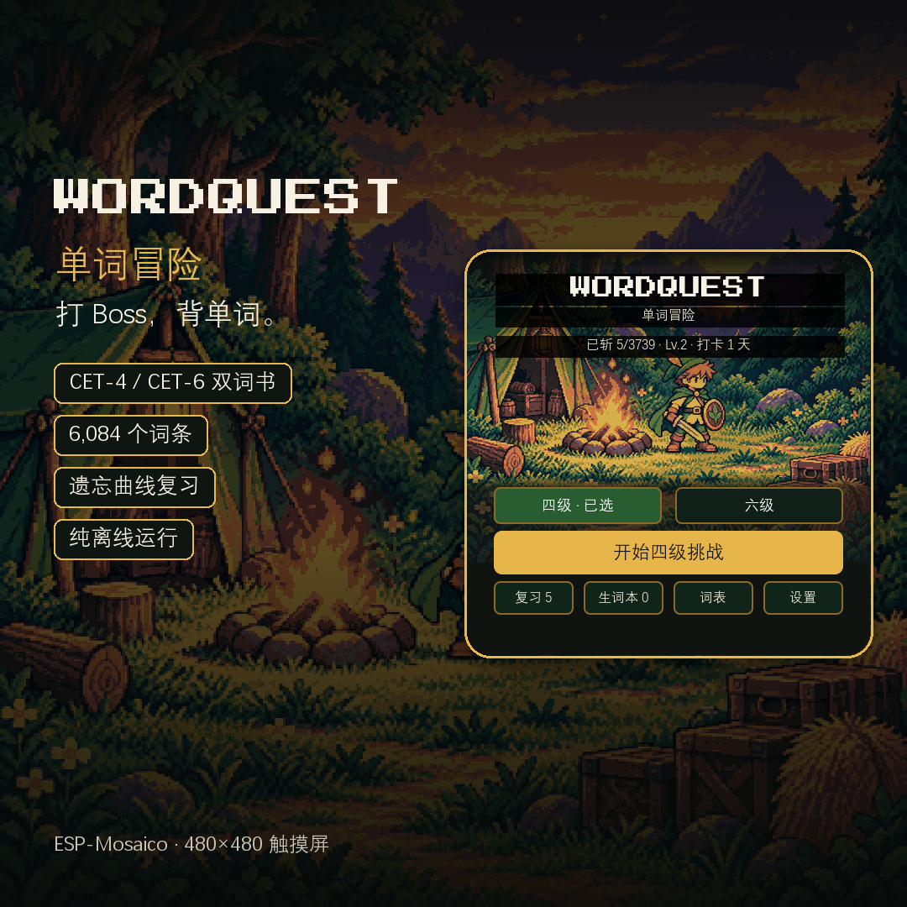
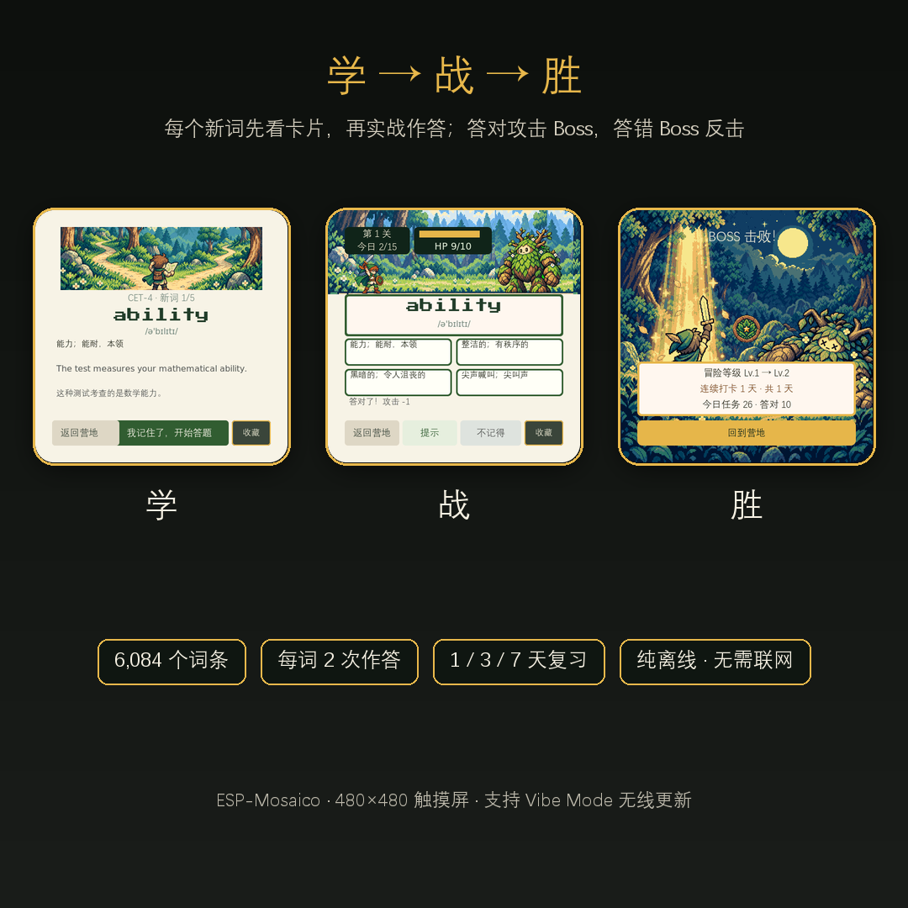
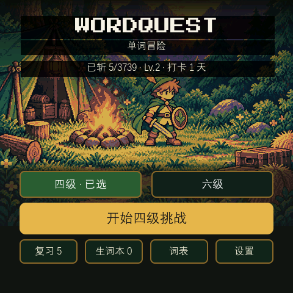
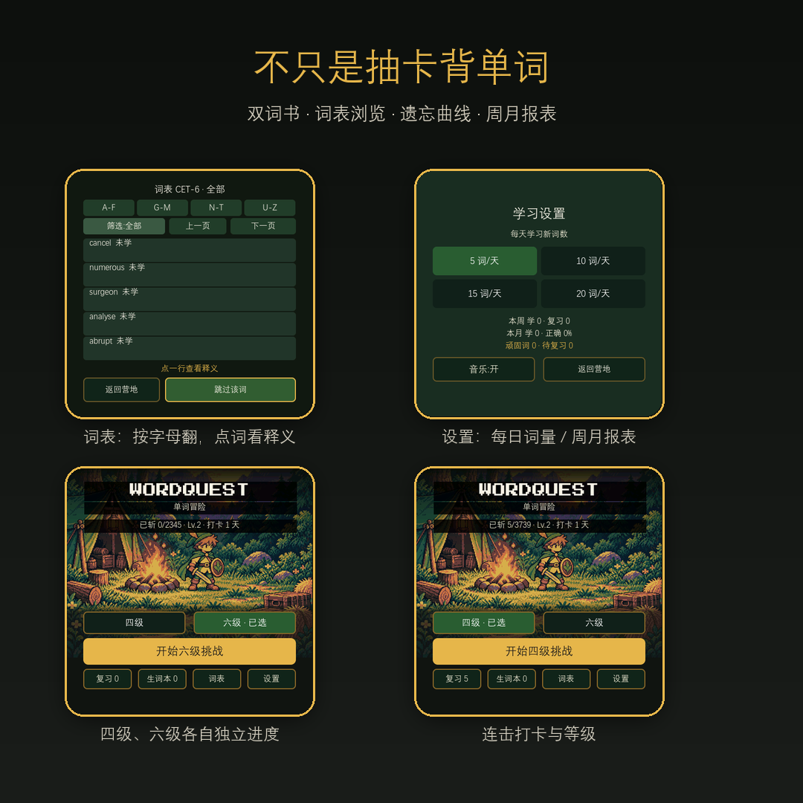
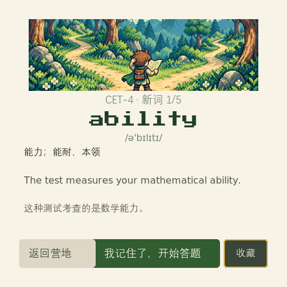
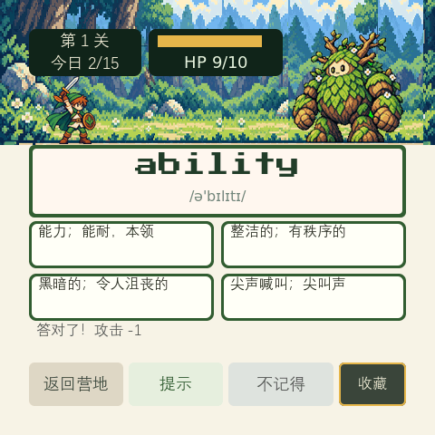
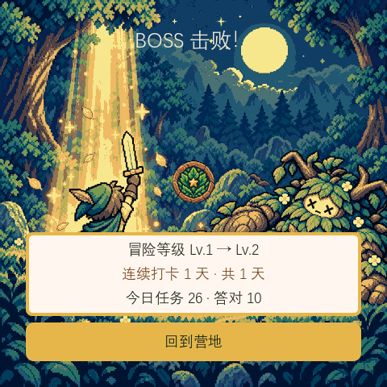
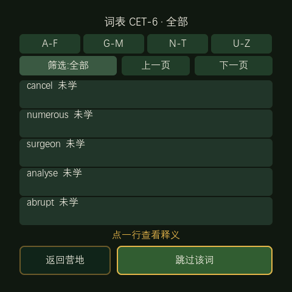

# WordQuest 单词冒险

**在像素营地里打 Boss 背单词。** 每天几个新词，看卡片、做选择，答对就是一刀，把 Boss 砍翻为止。

ESP-Mosaico 是一块 480×480 的圆角触摸屏，竖着握在手里正好像一台迷你掌机。WordQuest 就是照着这个尺寸做的：整屏像素营地，一屏一个动作，所有按钮都能用大拇指点到。

---

## 一局是怎么打的

1. **学**：新词先出一张卡片 —— 单词（像素字体）、音标、中文释义，配一句英文例句和中文翻译。
2. **战**：合上卡片立刻来一道四选一，选对就攻击 Boss，选错 Boss 反击并把这道题排到队尾重答。
3. **胜**：HP 清零，Boss 倒下，结算本局经验与打卡天数，回营地继续。

营地就是主界面：上面一行是「已斩 / 等级 / 打卡」，中间是四级、六级两本词书和今天的主按钮，下面一排是复习、生词本、词表、设置。

## 功能

- **双词书，独立进度**：CET-4（3739 词）与 CET-6（2345 词），随时切换，互不干扰。
- **6,084 个词条内置离线**：释义、音标、例句全部打包进固件，不联网也能学。
- **遗忘曲线复习**：每个词按 1 / 3 / 7 天三档推进，答错打回第一档；主页上的「复习 N」就是今天到期的词。
- **顽固词优先**：答错或点「不记得」的词进错题本，第二天复习时先占名额，答对才毕业。
- **生词本**：答题页随手一按收藏，之后可以只练收藏的词。
- **词表浏览**：按字母区间翻页，按「全部 / 未学 / 已学 / 跳过」筛选，点一行看释义；生僻词可以直接跳过，以后不再派给你。
- **每日词量**：5 / 10 / 15 / 20 词，随时改。
- **打卡与等级**：连续打卡天数、冒险等级，结算页一起结算。
- **周 / 月报表**：本周学了多少、复习多少，本月正确率多少。
- **芯片风音乐与音效**：双声部实时合成，营地与战斗两首曲子，可一键关掉。
- **断电不丢**：词书、每日词量、收藏、顽固词、复习排期、打卡、报表全部写进 NVS，写完读回校验，写失败会重试。

## 怎么操作

全程触摸，不需要键盘：

| 位置 | 动作 |
| --- | --- |
| 主页「开始 X 级挑战」 | 今天的新词回合 |
| 主页「复习 N」 | 只做今天到期的复习 |
| 主页「生词本 N」 | 只练收藏过的词 |
| 主页「词表」 | 浏览、筛选、看释义、跳过生僻词 |
| 主页「设置」 | 每日词量、周月报表、音乐开关 |
| 答题页「提示 / 不记得 / 收藏」 | 看释义首字提示、认输重排、收藏 |

## 更多截图

| 画面 | 说明 |
| --- | --- |
|  | **学习卡**：单词、音标、中文释义，配英文例句与翻译 |
|  | **答题**：答对就攻击 Boss，血条与关卡同步；答错 Boss 反击 |
|  | **结算**：等级、连续打卡、本局战果，一键回营地 |
|  | **词表**：字母区间、筛选、翻页、释义，可跳过生僻词 |

## 硬件与安装

- 机型：ESP-Mosaico（ESP32-S31，480×480 圆角触摸屏）。社区发布版要求 **Vibe Mode 0.2.0 及以上、v2 产品契约与 ABI 2**。
- **下载固件**：[`firmware/wordquest-v0.2-system-update.irisfw`](firmware/wordquest-v0.2-system-update.irisfw) · 2,269,436 字节 · SHA-256 `25d1dac8ddf2c230ffcbbee3400eb21022086b7dd309318c0883e12db8b316c1`（`esp-iris-system-update/0.2`，release 1.0.0，最低 Vibe Mode 0.2.0）。
- 安装：用 Vibe Mode（0.2 及以上）的系统更新写入，USB 或无线通道都行。包内含应用、匹配的分区表与 `ui_apps` 资源，不含 Bootloader 或 Vibe Mode 固件。
- 旧的 `/v1` 格式包不能用于当前社区上传，也不能据其最低版本字段推断 0.2 兼容。
- 0.2 发布构建与迁移记录见 `docs/release-v02/`。旧设备迁移到 Vibe Mode 0.2 是单独的官方基础固件升级流程，应用包不负责此升级。
- 界面与学习流程已有 0.1 真机和共享 C 模拟器证据；0.2 发布包的构建/校验结果以 `docs/release-v02/` 记录为准，尚未在 0.2 设备上实测。
- 也可以从源码重建：`python mosaico.py iris system-update --project projects/wordquest`（需 0.2 工具链）。

## 技术要点

- UI 用 ESP-GSP 场景（esp-gsp 1.5.1 / gspc 0.7.0）搭建，逻辑在共享 C 代码里，同一份代码可以在 PC 模拟器里跑完整流程。
- 资源上限很紧：`ui_apps` 1.5 MiB 装下 969 KB 的 16px 中文字库、394 KB 图像和整套场景；词库（429 KB zlib）压在应用镜像里，启动时解压到 PSRAM。
- 中文动态文本全部走同一个 16px 全量字库，靠实测字宽表做换行，所以长词、长例句不会断得难看。
- 有 5 套原生回归：模型/进度 800 组种子会话、设置持久化丢写、顽固词与跳过、遗忘曲线与报表、文本换行 5 万组用例。

## 已知限制

- **没有单词发音**。做过一版设备端音素合成，8 kHz 的共振峰合成在实机上听起来分辨不出单词，于是撤掉，没有留半成品；离线音频包按 6,084 词算约 29 MB，远超 flash 容量。
- 目前只有 CET-4 / CET-6 两本词书，没有云同步、没有账号。
- 为 480×480 圆角屏做的排版，换到别的分辨率需要重新排。
- 词条释义来自下面提到的开源词表，个别条目中文有瑕疵（例如 `general` 的释义里混进了一个孤立的 `n`）。

## 数据来源与许可

- 应用代码与美术资源：MIT（见 `LICENSE`）。
- 词条数据来自 GitHub 开源项目 [kajweb/dict](https://github.com/kajweb/dict) 的 CET-4 / CET-6 词表（该仓库未声明许可证，内容来自公开词典），本项目仅作个人学习用途使用；如需商业发布请替换为已授权词表。
- 字体：DengXian / DejaVu / Press Start 2P 的子集，均嵌入固件。
